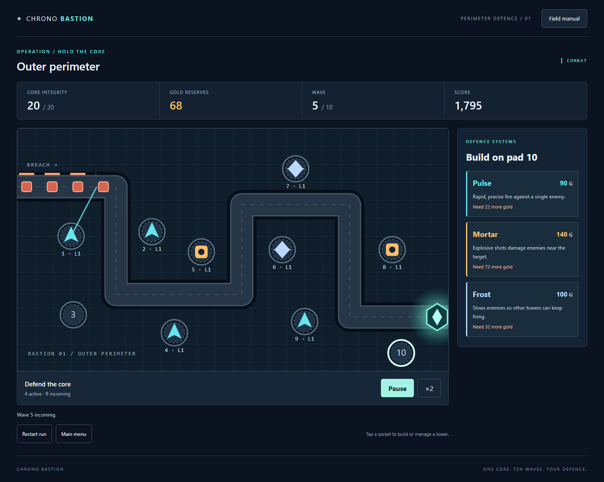

# Chrono Bastion

A single-player C# tower defence game. Protect an energy core through ten waves
with Pulse, Mortar and Frost towers. Built with .NET 10 and standalone Blazor
WebAssembly; the entire battle runs in your browser.

**Team:** Yerkingali Saruar (F1j1tun1) and Ainabek Chingiskhan (Chingiskhan07), IT-2502.



## Play

The release destination is [GitHub Pages](https://f1j1tun1.github.io/IFP_Final/).
See [verification](docs/VERIFICATION.md) for the deployment status and checks.

1. Choose **Deploy defences**. Select a numbered pad, then a tower.
2. **Pulse** fires rapidly; **Mortar** hits groups; **Frost** slows enemies.
3. Select a tower to upgrade, sell or choose First, Strongest or Nearest targeting.
4. Start each wave when ready. You can build during combat or pause to plan.
5. Clear all ten waves to win. A destroyed core ends the whole run.

**Pause / Resume** stops combat. **×1 / ×2** changes speed. Opening the field
manual or hiding the tab pauses a battle; returning never resumes automatically.
Restarting or leaving a run asks for confirmation. **Play again** starts from
wave one with 300 gold and 20 core health.

Only the best finished-run record is stored locally. There are no checkpoints,
saved ongoing games, accounts or online leaderboard. Clearing browser data clears
the record. Blocked or damaged storage does not prevent play.

On a phone, tap the board or use the large numbered pad buttons below it, then
choose an explicit action. On a keyboard, Tab moves focus and Enter activates
buttons; Enter or Space selects a board pad. The field manual explains enemy
armor, targeting and the final boss.

## Run in VS Code on Windows

Install the **.NET 10 SDK**, Git and VS Code with C# Dev Kit. Clone and open the
folder containing `ChronoBastion.sln`:

```powershell
git clone https://github.com/F1j1tun1/IFP_Final.git
cd IFP_Final
code .
dotnet restore
dotnet run --project src/ChronoBastion.Web --launch-profile http
```

Open `http://localhost:5042`. Keep the terminal open; Ctrl+C stops the server.
The same dotnet commands work on Linux and macOS with .NET 10.

## Verify

```powershell
pwsh -File scripts/Test.ps1
pwsh -File scripts/Publish-Pages.ps1
```

The first script runs unit/component tests and both complete simulations. The
second produces the static release in `artifacts/pages/wwwroot`, with the
`/IFP_Final/` base path, `.nojekyll` and a 404 fallback.

For the actual browser suite, also install **Node.js 24** and run:

```powershell
pwsh -File scripts/Test-Browser.ps1
```

It installs isolated Chromium/Firefox test browsers, packages the release and
plays through ordinary interface actions. It checks a complete victory, defeat,
fresh restart, storage failure, controls and mobile viewports. It creates real
screenshots in `docs/screenshots` and a report in `artifacts/browser-results.json`.
No cheat controls or modified game state are used. Allow several minutes.

To verify an existing deployment with the same suite:

```powershell
$env:GAME_URL = 'https://f1j1tun1.github.io/IFP_Final/'
npm run test:browser
```

## Project structure

| Folder | Responsibility |
|---|---|
| `src/ChronoBastion.Core` | Pure rules, immutable records, map and catalogs |
| `src/ChronoBastion.Application` | Single session, fixed-step time and record codec |
| `src/ChronoBastion.Web` | SVG battlefield, reusable components, browser adapters |
| `tests/ChronoBastion.Tests` | Core and Application tests |
| `tests/ChronoBastion.Web.Tests` | Component and browser-storage adapter tests |
| `tests/browser` | Playwright checks of the packaged game |
| `tools/ChronoBastion.Simulator` | Legal winning and undefended losing runs |

## Documentation and presentation

- [Architecture and state flow](docs/ARCHITECTURE.md)
- [Public API](docs/API_CONTRACT.md)
- [Rules and tested strategy](docs/GAME_DESIGN.md)
- [Interface specification](docs/UI_SPEC.md)
- [Verification evidence and limitations](docs/VERIFICATION.md)
- [GitHub Pages deployment](docs/DEPLOYMENT.md)
- [Assessment coverage](docs/REQUIREMENTS_MATRIX.md)
- [Defense notes](docs/DEFENSE.md)
- [Asset credits](docs/ASSETS.md)

There are exactly two ownership parts: Yerkingali supplied the engine, session,
simulator, domain tests and architecture; Ainabek supplied the interface, browser
integration, interface tests, final presentation and release work.

The supplied assessment defines the grading criteria. Alex Yagur's *Functional
Programming with C#* (Packt, 2024) supplies the course concepts and tower-defence
exercise context. The book and assessment files are not redistributed.

[Download the final presentation](docs/presentation/Chrono-Bastion.pptx). Speaker notes include a demo sequence and defense explanations.
