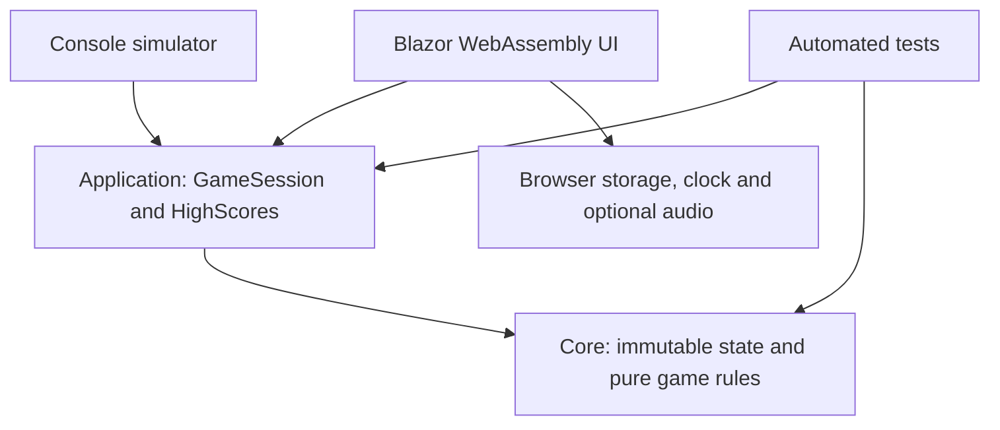
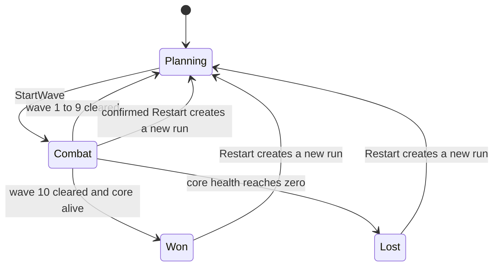

# Chrono Bastion architecture

The project separates deterministic game rules from browser interaction. Part 1
provides a complete simulation; Part 2 renders and controls that simulation.
The whole game runs on the player's device. Hosting serves static files.

## Dependencies



Core references only the .NET base libraries. Application references Core.
Web references Application and can use the transitive Core types. Neither Core
nor Application depends on Blazor, a database, JavaScript or network access.

## Ownership in exactly two parts

| Part | Owner | Complete responsibility |
|---|---|---|
| 1 | Yerkingali Saruar | Architecture, Core, Application, simulator, domain tests, contract and handoff |
| 2 | Ainabek Chingiskhan | Blazor UI, browser adapters, UI/browser tests, final documentation/presentation and deployment |

Part 2 consumes the public contract. A core defect may be fixed with a regression
test, but no engine redesign or additional return-to-Part-1 stage is planned.

## Files and responsibilities

| Location | Responsibility |
|---|---|
| Core/Model | GameState, entity records, commands, transitions, errors and effects |
| Core/Content | One map, immutable tower/enemy catalogs, recursive wave definitions |
| Core/Rules | Pure damage, movement, target selection and display queries |
| Core/Functional | Small Option and Result types with Map/Bind/Match |
| Core/GameEngine.cs | Command validation and one deterministic simulation tick |
| Application/GameSession.cs | The single mutable state owner and elapsed-time accumulator |
| Application/HighScore.cs | Finished-run records, comparison, validated JSON serialization |
| Web/Program.cs | Blazor startup; GameSession already registered as scoped |
| Web/Pages/Home.razor | Replace the starter shell with the final application |

Recommended Part 2 additions are `Components/GameBoard.razor`, `GameHud.razor`,
`TowerPanel.razor`, `MainMenu.razor`, `ResultDialog.razor`, `HelpDialog.razor`,
`Services/BrowserHighScoreStore.cs`, and `wwwroot/js/browser.js`. These names are
suggestions; the public Core/Application API is the stable integration boundary.

## State machine



Pause is a flag within Combat, not a second battle state. Building, upgrading,
selling and changing target priority work in Planning and Combat, including while
paused. Wave start is allowed only in Planning. Finished games reject every
command except Restart. Restart is also available before a run ends; the UI asks
for confirmation while a run is in progress.

`WaveNumber` is zero before the first wave and then the current/last started wave.
`WavesCleared` is the count actually completed. In Planning, the next wave label
is `WaveNumber + 1`. At victory, both are ten. Defeat never increments WavesCleared.

## One command

```mermaid
sequenceDiagram
    participant UI
    participant Session as GameSession
    participant Engine as GameEngine
    UI->>Session: Dispatch(command)
    Session->>Engine: Execute(State, command)
    alt valid
        Engine-->>Session: Success(new state, events)
        Session->>Session: replace State
        Session-->>UI: Updated(transition)
    else invalid
        Engine-->>Session: Failure(GameError)
        Session-->>UI: return failure; keep State unchanged
    end
```

Failure does not publish Updated. Display `GameError.Message` from the returned
Result. Core rules are authoritative even when UI buttons are disabled.

## One tick

Each tick represents exactly 50 milliseconds of game time:

1. Spawn enemies whose scheduled tick has arrived.
2. Process towers in ascending pad ID order. Reduce cooldown, select a living
   target in range, apply immediate damage/status effects, and emit ShotFired.
3. Remove dead enemies and award their gold/points exactly once.
4. Move surviving enemies; expired slow effects return to normal speed.
5. Remove escaped enemies and subtract core health, clamping at zero.
6. Resolve defeat first. Otherwise, complete a wave only when no enemies remain
   and every scheduled spawn has occurred. Wave ten produces victory.

Projectiles and explosions are visual effects in Part 2. ShotFired reports an
already-applied hit; the UI must not apply damage when an animation arrives.
Simultaneous target ties use the lower enemy ID. The engine never reads the clock,
files, storage, or random values. Identical inputs produce identical outcomes.

## Time and state ownership

Web measures elapsed wall-clock time and calls `GameSession.Advance(TimeSpan)`.
The session accumulates it into fixed ticks. Speed 2 doubles the number of ticks,
not damage or movement per tick. Do not multiply elapsed time in Web as well.

Each Advance call accepts at most 250 ms of elapsed time before speed scaling,
so one callback processes at most 5 ticks at speed 1 or 10 at speed 2. Extra time
is discarded. Paused/planning/finished states discard elapsed time. Pause, speed,
wave start and restart commands clear the partial-tick accumulator.

The session publishes one update per Advance call that performed ticks, combining
their effects. Subscribe once and unsubscribe when the owning component is
disposed. Dispatch and Advance must run serially on Blazor's synchronization
context; GameSession is deliberately not a multithreaded service.

## Immutability and performance

GameState and entities are records containing ImmutableArray collections. Commands
and ticks return fresh values. Local lists/builders inside a tick are private
working buffers; no input collection or input entity is mutated.

Work is bounded by ten tower pads and small, finite waves. The map and catalogs
are shared immutable data. No network request happens per frame. Visual effects
need their own capped, expiring list in Web; do not keep the entire event history.
Profile the real UI before adding pooling or other complex optimizations.

## Persistence and failure boundaries

Only `HighScore` is persistent. Application handles JSON and validation; Web handles
localStorage and its exceptions. An unreadable record becomes a visible, nonfatal
warning and an empty in-memory record. A write failure must not interrupt gameplay.
The record is local to a browser/origin and is not a cheat-proof online leaderboard.

GameState is trusted engine data, not an import format. Never load arbitrary state
from storage or let UI code construct battle snapshots to change gameplay.
Programming mistakes can throw; expected player mistakes return typed errors.

## Hosting

Standalone Blazor WebAssembly produces static files. The Pages build changes the
base URL to `/IFP_Final/`, adds `.nojekyll`, and supplies a 404 fallback. Local
development retains `/`. Use relative asset URLs so both locations work.
Publication is manual until the completed graphical game passes Part 2 checks.
